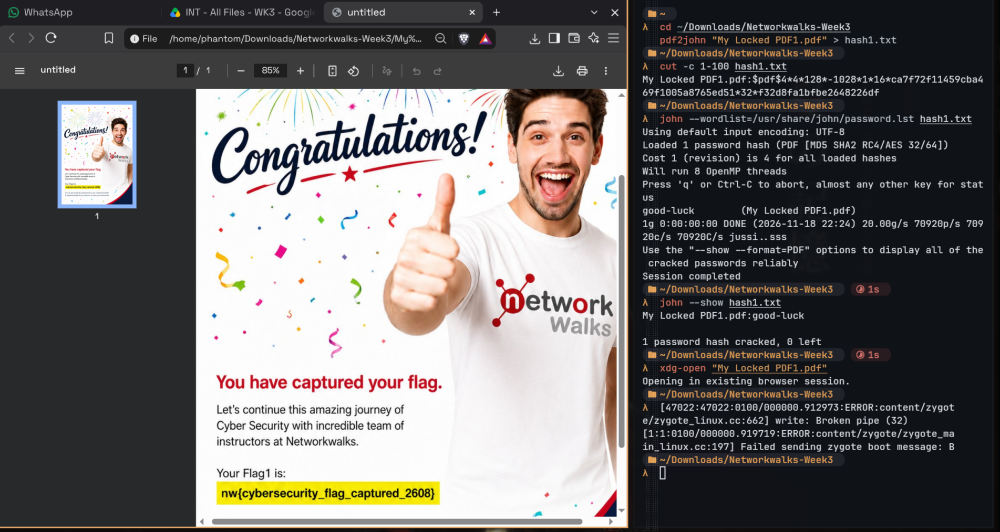
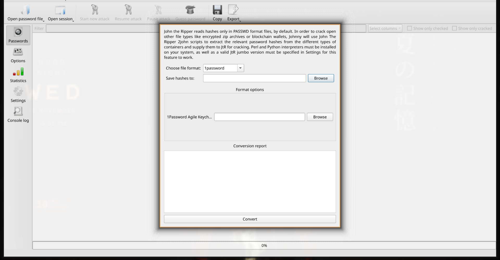
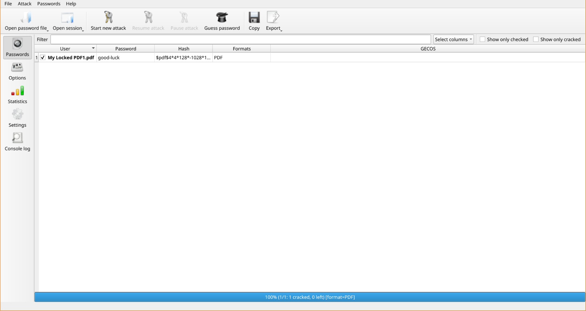
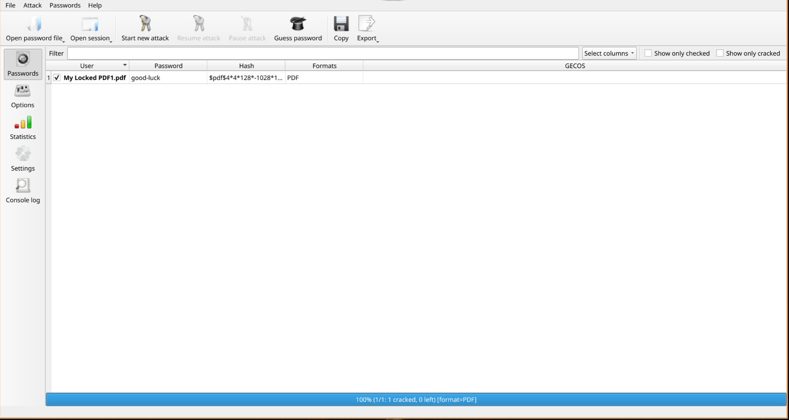
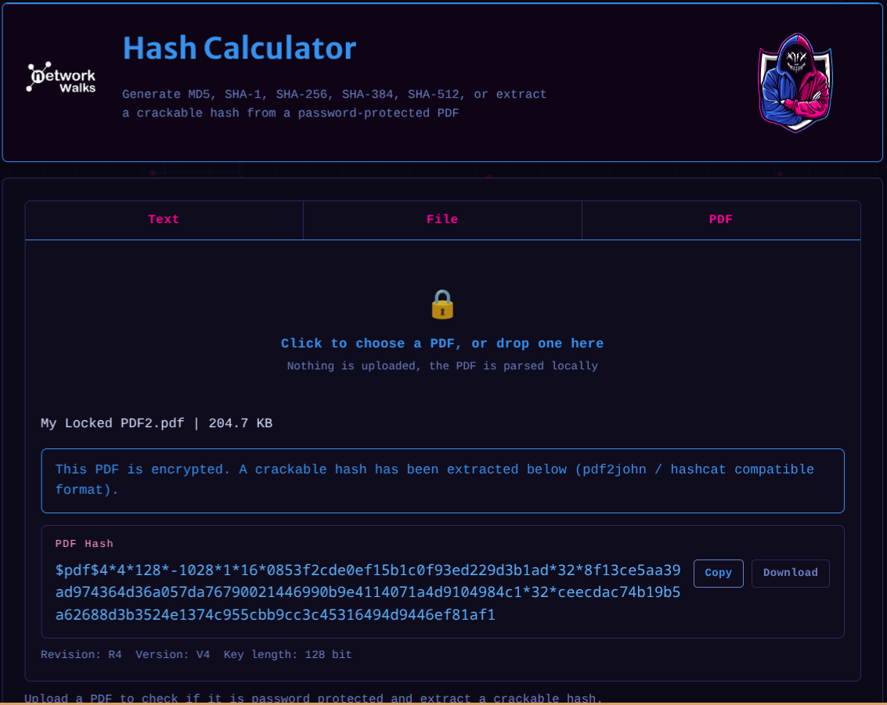
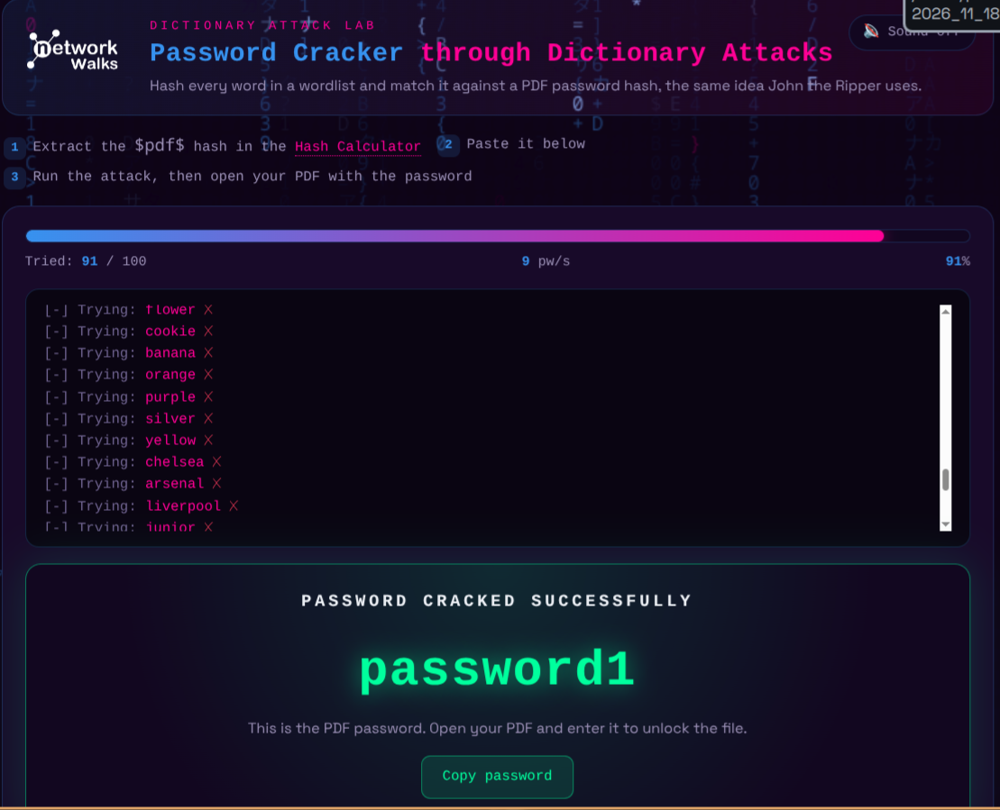
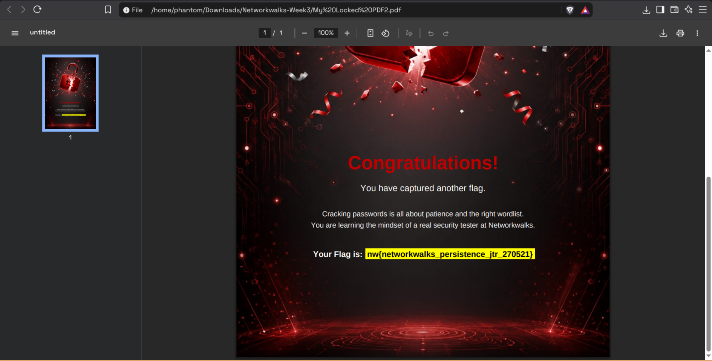

# 🔐 Networkwalks Cybersecurity Internship — Week 3

**Password Cracking with John the Ripper & Networkwalks Tools**


---

## 📖 Introduction

This is my Week 3 project for the Networkwalks Cybersecurity Internship (Batch B084).

This week, I worked on password cracking using John the Ripper, its graphical interface Johnny, and the online tools provided by Networkwalks.

I completed the exercises on **Ryoku Linux**, an Arch-based Linux distribution, instead of using Kali Linux. The main aim was to understand how password hashes are extracted from encrypted PDF files and how dictionary attacks can be used to recover passwords.

All password-recovery tests were performed on the practice PDFs provided for the internship.

## 🎯 Objectives

- Understand the basics of password cracking and dictionary attacks.
- Extract password hashes from encrypted PDF files.
- Use John the Ripper through the Linux terminal.
- Explore Johnny, the graphical interface for John the Ripper.
- Use the Networkwalks Hash Calculator and Password Cracker.
- Verify recovered passwords by unlocking the provided PDFs.
- Capture the flags and document the practical results.

## 🖥️ Lab Environment

| Component | Details |
|---|---|
| Operating System | Ryoku Linux (Arch-based) |
| Password Cracking Tool | John the Ripper 1.9.0-jumbo-1 |
| GUI | Johnny |
| Hash Extraction | pdf2john |
| Attack Method | Dictionary Attack |
| Wordlist | `/usr/share/john/password.lst` |
| Online Tools | Networkwalks Hash Calculator & Password Cracker |
| Lab Files | My Locked PDF1.pdf, My Locked PDF2.pdf |

---

# 🔹 Project Module 1 — Password Cracking with JTR

## Step 1: Checking John the Ripper

I first checked whether John the Ripper and pdf2john were available on my system.

```bash
john --list=build-info
command -v pdf2john
```

John the Ripper version `1.9.0-jumbo-1` was available, and `pdf2john` was located at `/usr/bin/pdf2john`.

## Step 2: Extracting the PDF Hash

I used the first encrypted practice PDF for this module.

```bash
cd ~/Downloads/Networkwalks-Week3
pdf2john "My Locked PDF1.pdf" > hash1.txt
```

This extracted the password hash from the PDF and saved it in `hash1.txt`.

I checked the beginning of the extracted hash using:

```bash
cut -c 1-100 hash1.txt
```

The extracted hash used the `$pdf$` format, which John the Ripper supports.

## Step 3: Running a Dictionary Attack

After extracting the hash, I used John the Ripper with its password wordlist.

```bash
john --wordlist=/usr/share/john/password.lst hash1.txt
```

John tested passwords from the wordlist against the extracted hash.

The attack successfully recovered the password:

**Recovered Password:** `good-luck`

I verified the result using:

```bash
john --show hash1.txt
```

The terminal displayed:

```text
My Locked PDF1.pdf:good-luck

1 password hash cracked, 0 left
```

## Step 4: Verifying the Password

I opened the encrypted PDF and entered the recovered password.

```bash
xdg-open "My Locked PDF1.pdf"
```

The PDF opened successfully and displayed the Networkwalks congratulations page containing the first flag.

**Flag 1:** `nw{cybersecurity_flag_captured_2608}`

### 📸 John the Ripper Result and PDF Verification



## Step 5: Using Johnny GUI

I also installed Johnny, the graphical interface for John the Ripper, from the Arch User Repository.

```bash
yay -S johnny-git
```

After installation, I launched it using:

```bash
johnny
```

I loaded the previously extracted `hash1.txt` file into Johnny.

Johnny recognized the PDF hash and displayed the password already recovered by John the Ripper.

The GUI showed:

- File: `My Locked PDF1.pdf`
- Format: PDF
- Password: `good-luck`
- Result: 1 cracked, 0 remaining

Johnny was used to view and verify the saved cracking result. I did not perform a separate cracking run through the GUI.

### 📸 Johnny GUI Screenshots







### PM1 Result

The first module helped me understand how John the Ripper works with encrypted PDF hashes. I was able to extract the hash, recover the password using a dictionary attack, and successfully unlock the PDF.

---

# 🔹 Project Module 2 — Password Cracking with Networkwalks Tools

## Step 1: Extracting the Hash Using Hash Calculator

For the second module, I used the Networkwalks Hash Calculator.

**Tool:** https://networkwalks.com/hash-calculator/

I selected the PDF option and uploaded the second practice file, `My Locked PDF2.pdf`.

The tool identified the PDF as encrypted and extracted a compatible password hash.

The displayed information included:

| Property | Result |
|---|---|
| File | My Locked PDF2.pdf |
| Encryption Revision | R4 |
| PDF Version | V4 |
| Key Length | 128 bit |
| Hash Format | `$pdf$` |

### 📸 Hash Calculator



## Step 2: Running the Networkwalks Password Cracker

Next, I opened the Networkwalks Password Cracker.

**Tool:** https://networkwalks.com/password-cracker/

I copied the extracted PDF hash from the Hash Calculator and pasted it into the Password Cracker.

The tool performed a dictionary attack by testing passwords from its wordlist against the hash.

The attack successfully recovered the password:

**Recovered Password:** `password1`

The screenshot showed the successful result after 91 of the 100 listed password attempts.

### 📸 Password Cracker Result



## Step 3: Unlocking the Second PDF

After recovering the password, I opened the second PDF using:

```bash
xdg-open "My Locked PDF2.pdf"
```

I entered `password1`, and the PDF opened successfully.

The unlocked document displayed the second Networkwalks flag.

**Flag 2:** `nw{networkwalks_persistence_jtr_270521}`

### 📸 Flag 2 Verification



### PM2 Result

The Networkwalks tools provided a browser-based method for extracting a PDF hash and testing passwords against it.

I successfully recovered the password for the second practice PDF and verified it by opening the document.

---

## 📊 Final Results

| Module | Tool | File | Password | Result |
|---|---|---|---|---|
| PM1 | John the Ripper CLI | My Locked PDF1.pdf | `good-luck` | Success |
| PM1 | Johnny GUI | My Locked PDF1.pdf | `good-luck` | Saved result displayed |
| PM2 | Networkwalks Tools | My Locked PDF2.pdf | `password1` | Success |

Both flags were successfully captured from the provided practice files.

## 🧠 What I Learned

During this week's project, I learned how password cracking works in a practical environment.

I understood that tools like John the Ripper don't simply reveal a password directly from a hash. Instead, they test password guesses and check whether they match the encrypted file's password-verification data.

I also learned how useful a wordlist can be during a dictionary attack. The success of the attack depends partly on whether the correct password is included in the list being tested.

Another thing I learned was that the same basic process can be performed using both command-line tools and browser-based tools.

## 🔒 Security Takeaways

This exercise showed me why common and predictable passwords are risky.

Passwords that appear in commonly used wordlists can be recovered through dictionary attacks, especially when attackers can obtain password-verification data and test guesses offline.

Using long, unique passwords or passphrases helps reduce the risk of this type of attack.

## 📝 Conclusion

Week 3 was a useful hands-on experience because I got to work with both terminal-based and browser-based password cracking tools.

I used Ryoku Linux for the practical work, successfully recovered the passwords for both internship practice PDFs, and captured the two flags.

This project helped me understand PDF hash extraction, dictionary attacks, password verification, and the importance of strong passwords.

All testing was limited to the authorized lab files provided for this internship.

---

**Networkwalks Cybersecurity Internship | Batch B084 | Week 3**

*Completed on Ryoku Linux — November 2026*
